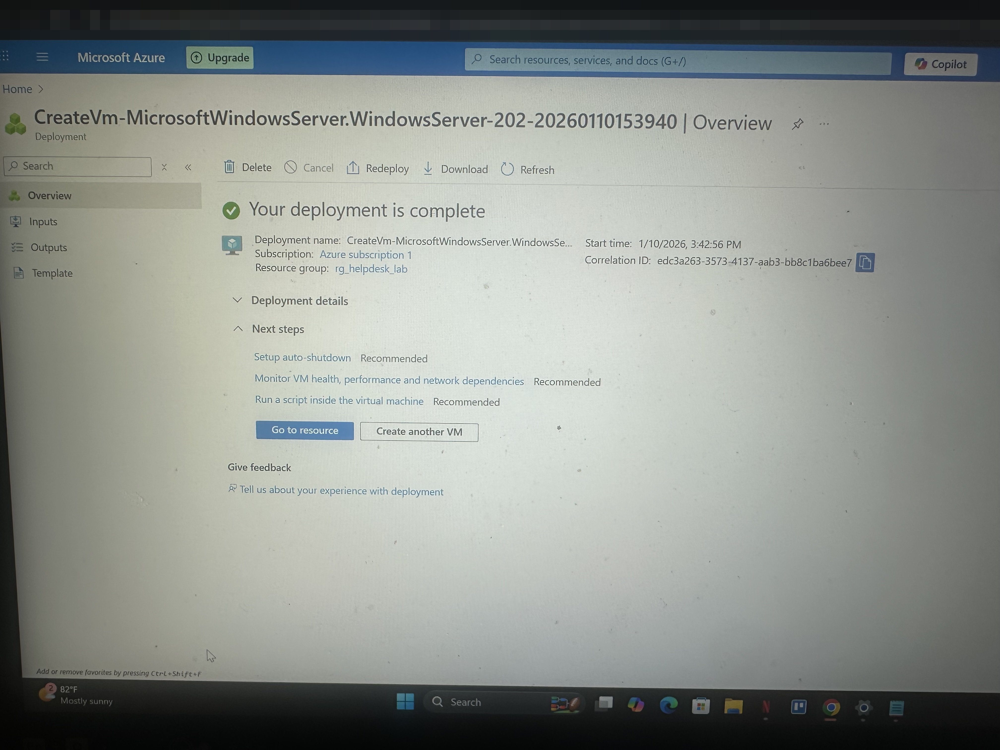
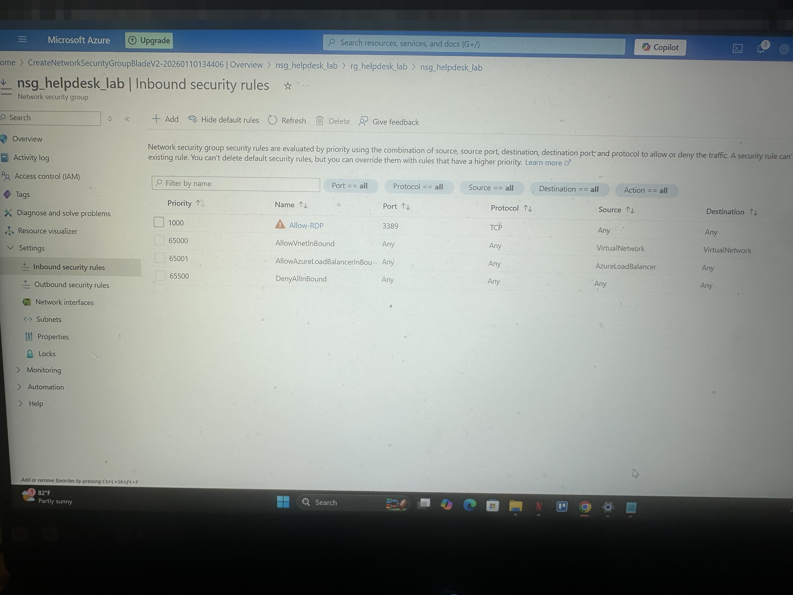
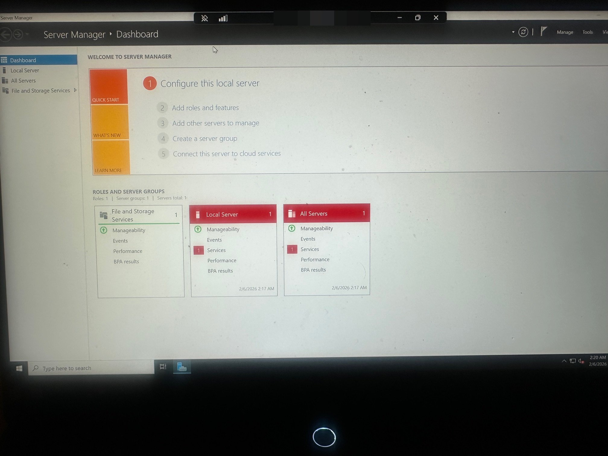
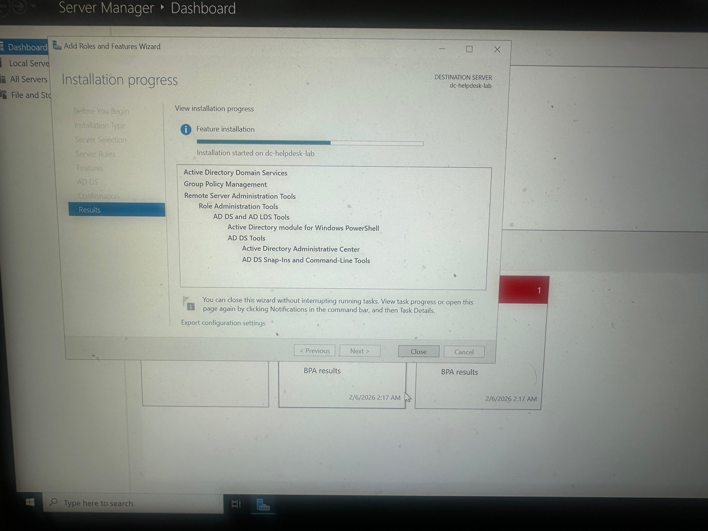
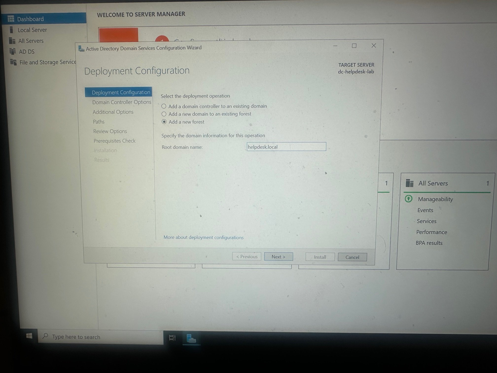
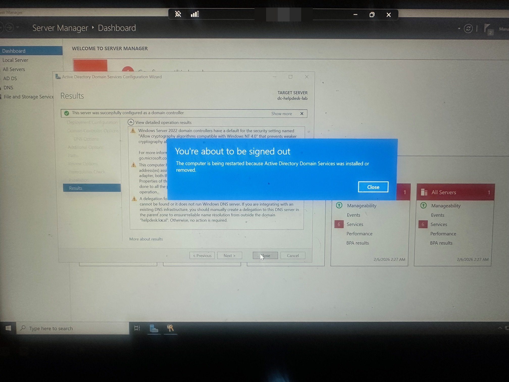

# Azure Help Desk Lab: Active Directory on Azure

I built a cloud-hosted Active Directory environment on Azure to practice common Help Desk tasks: creating users, creating user groups and resetting user passwords.

**Status:** Completed

## Technologies

- Microsoft Azure (Virtual Network, Network Security Group, Virtual Machine)
- Windows Server 2022 (Desktop Experience) (AD DS + DNS)
- Remote Desktop (RDP)

## Architecture

| Resource | Name | Details |
|---|---|---|
| Resource group | `rg_helpdesk_lab` | Lab budget of $25 configured |
| Virtual network | `vnet_helpdesk_lab` | `10.0.0.0/16` |
| Subnet | `subnet_internal` | `10.0.1.0/24` |
| Network security group | `nsg_helpdesk_lab` | Inbound RDP (TCP 3389) |
| Domain controller VM | `dc-helpdesk-lab` | Windows Server 2022, Standard B2ls v2 (2 vCPU, 4 GiB) |
| AD forest / domain | `helpdesk.local` | New forest |

## Build steps

1. **Account & cost control:** set a $25 spending budget and created the resource group.
2. **Networking:** created the virtual network and internal subnet.
3. **NSG:** created the network security group and added an inbound RDP rule (port 3389).
4. **Domain controller VM:** deployed Windows Server 2022 into the subnet with the NSG attached.
5. **Connect:** signed in to the VM over RDP.
6. **Active Directory:** installed the AD DS role, promoted the server to a domain controller in a new forest (`helpdesk.local`), and rebooted.
7. **Help Desk tasks:** created a user, created a user group, and reset the user's password in Active Directory.

## Screenshots

| | |
|---|---|
| **DC VM deployment**  | **NSG inbound RDP rule**  |
| **Successful RDP session**  | **AD DS role installation**  |
| **New forest: `helpdesk.local`**  | **Promoted to domain controller, rebooting**  |

## Video walkthroughs (Loom)

- [Setting up the Azure virtual network](https://www.loom.com/share/9a74b4afcff943c0aa01a2d023c4569d)
- [Configuring the NSG RDP rule](https://www.loom.com/share/a226d61e67f0474e9ad12862d557bff1)
- [Creating the VM and connecting the VNet and NSG](https://www.loom.com/share/ca9b424bf2bb4c41938fa276c5f4763d)
- [Creating a user and user group, and resetting a password in Active Directory](https://www.loom.com/share/ea8f02c2eb4c44b28ffdd1e727ad4b34)

## What I'd change for production

- The RDP rule allows any source. In a real environment I'd restrict it to a known IP, or remove public RDP entirely and use Azure Bastion.
- Give the domain controller a static private IP and point the VNet's DNS at it so domain-joined machines resolve `helpdesk.local`.
